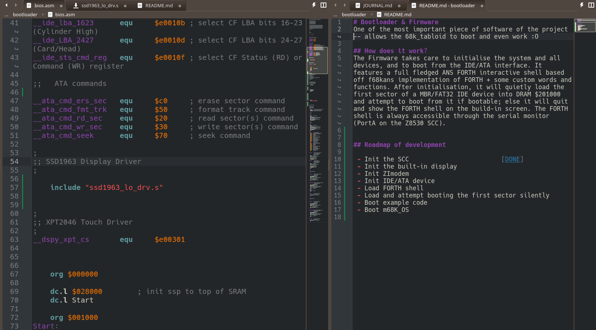
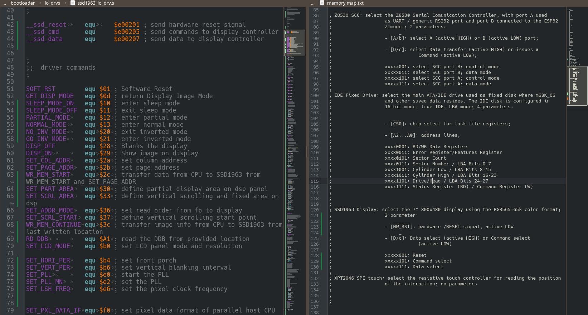
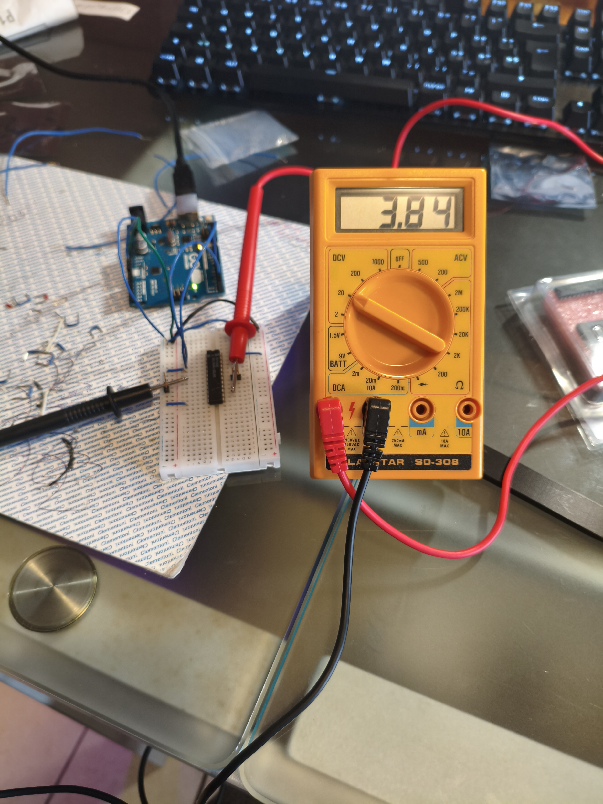

# JOURNAL.md

---
title: "68k_Tabloid"
author: "Alexandra"
description: "A 7" PDA powered by a MC68010 and electronic shenanigans. It features a custom POSIX-compliant OS, m68k_OS written specifically for this machine"
created_at: "2026-11-06"
---

## 06/11/2026-17:49 - New Development

Today I've worked on a few READMEs, most notably the one in /bootloader, where I addedd a roadmap of the expected work to do (must be expanded ngl) and began splitting the low level functions into their respecting files (a low level driver for the ssd1963, one for the xpt2046 etc...). I also began working on the ssd1963 low level driver (how unexpected) with the basic funcions to print text on the screen for now, it will be expanded in the high level version that will run into the OS.

**Total time spent: 1 hour 30 minutes**

## 06/11/2026-23:59 - ssd1963_lo_drv.s almost done

Today I also spent a lot of braincells on trying to terminate my low level driver in a single day, but apparently I wasn't able to :( I added a lot of subroutines that could be useful to write to, debug and manage the display. Tomorrow I hope to reserve a bit of time to finally finish this driver and move on toward the next driver.

**Total time spent: 2 hour 42 minutes**

## 07/11/2026 - bugfixes!

I was reviewing the code I wrote yesterday (well, actually Claude review it) and found some criticalities:
 - I missed every '#' in front of every driver command, that was easy to fix
 - `__write_memory_start` and `__set_partial_area` sent the wrong commands to the display (copy-paste shenanigans)
 - `__set_scroll_area` was dirtying d3 without clearing it first, a `clr.l d3` should do the job
 - there were a few  `rol.b #8` where they should've been `rol.w #8`
 - comments commenting the wrong things

After a bit of work I fixed all bugs and the control labels, driver commands and subroutines section are (almost) done. Now I have to implement `__set_hori_period`, `__set_vert_period`, `__set_pll`, `__set_pll_mn` and `__set_lshift_freq` before start implementing macros callable from the floor above (high level driver) and below (firmware).

Oh! I forgot to mentikon that I also had to rethink the MMIO for the display, since the SSD1963 requires a hardware reset signal during init.

**Total time spent: 1 hour 45 minutes**

## 08/11/2026 - hardware testings

Today I decided to dedicate myself on the hardware aspect of the project by soldering together 3 little 74LVC4245A breakouts I bought a while ago and testing a few gal20v8 I had found lying around to see if they were good.

I fired up my sooldering iron and I began soldering the headers to the breakout boards and after an hour they were all finished and I began testing them. I wrired them up to 5v on one side to see if they were converting the 5v to 3v3 and vice versa, and all the boards seems to work fine for now...

I also tested 2 GAL28V8 to see if they were good. I extracted them from 2 custom-made communication cards I found at my school while they were dismantling an old warehouse filled with old stuff, I also extracted 2 Z8530 SCC from them. Anyways, I found a new program called [GalForge](https://github.com/sillycowvalley/GalForge) on github which allows to program these PALs/GALs without using WinCUPL which is VERY convenient. I loaded the example program (a 2 to 4 decoder) and it turns out that only one of the two gal20v8 is working. I might need to find more programmable arrays logic or buy a CPLD.

**Total time spent: 2 hour 15 minutes**

