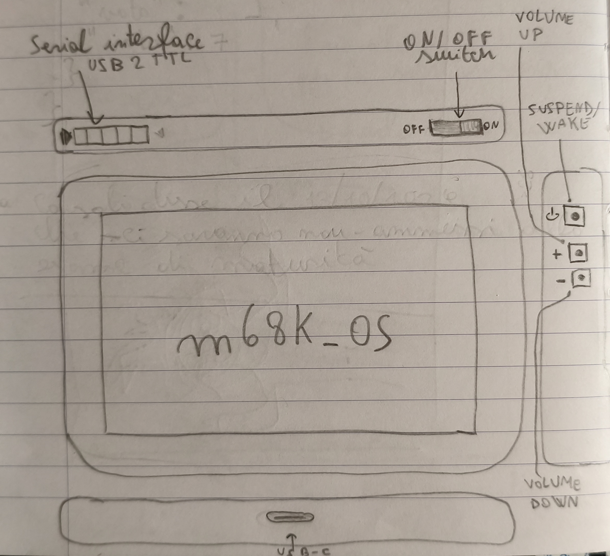

# 68k_Tabloid
A 7" PDA powered by a MC68010 and electronic shenanigans. It features a custom POSIX-compliant OS, m68k_OS written specifically for this machine

## What is this all about?
This is a personal project I started to learn more about how systems and computers work by designing, refining, and building my own computer system, and OSDEV by making my own custom Operating System.

This "tabloid", a PDA a bit larger than usual, is powered by a Motorola 68010 CPU clocked at 10MHz, with 4MB of DRAM SIMM 30-pin on a custom socket, an 7" 800x480 65K color display and even an ESP-32 running ZImodem!

The software that powers this contraption is a FORTH-based interactive shell, like OpenFirmware on old PPC Macs, equipped with custom words and a bootloader capable of loading the first sector of a MBR/FAT32-formatted IDE/ATA drive and execute the code contained in it (if bootable).
On top of this system runs the custom OS tailored for this device, m68K_OS, modelled on a subspecification of POSIX (because no MMU, so no `fork()` :P ), featuring the lwIP TCP/IP stack and other components useful for OS stuff.

## Hardware details

- MC68010P10 @ 10MHz
- 128kB of EPROM
- 32kB of SRAM
- 2MB - 12MB of DRAM 30-pin SIMM
- custom DRAM controller
- 2GB CompactFlash card/ IDE/ATA interface
- Z8530 Serial Communication Controller
- ESP32 WIFI modem (running ZImodem software) @ 32400 baud
- SSD1963-based 7" 800x480 RGB565 65K colours display with XPT2046-based resistive touch support
- beep speaker
- battery based on 18650 cells and respective cell controller and USB-C charging
- hardware timer sending interrupts every 100ms
- Real Time Clock!

## Software details

### Firmware
- interactive FORTH shell utilising the f68kans implementation, with some custom words and functions baked in
- MBR/FAT32 support
- bootloader loading the first sector onto RAM and then booting off of it
- division between Supervisor and User mode for running BIOS, OS kernel and user programs

### m68K_OS
- almost POSIX-Compliant kernel (true compat is not achievable due to no MMU support)
- lwIP TCP/IP network stack
- syscalls and exceptions through TRAPs
- newlibc as libc implementation
- GUI powered by Nano-X
